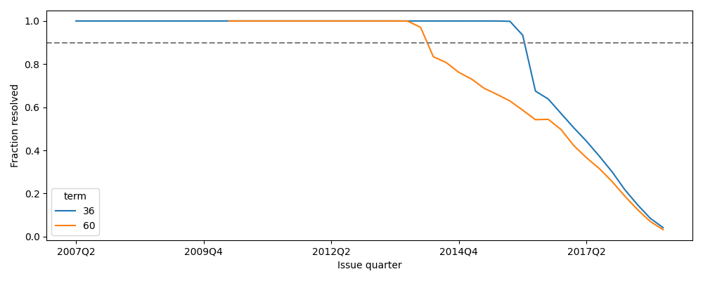
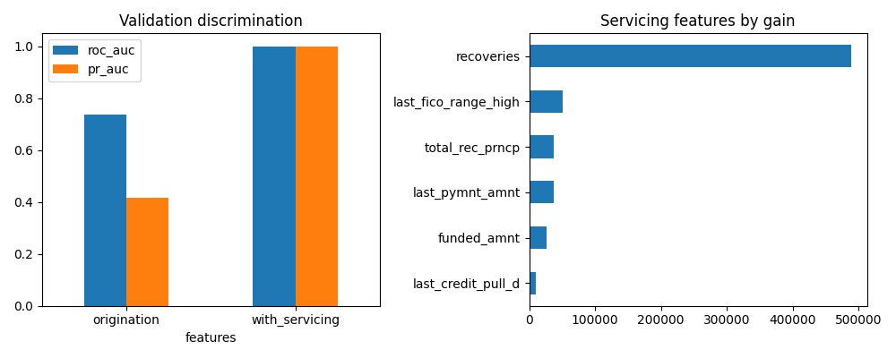
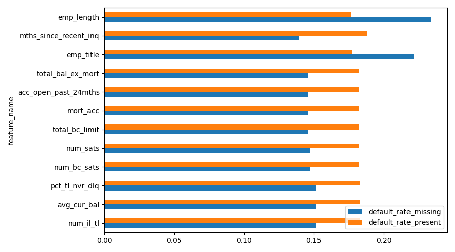

# Block 1 | Accepted-loan default prediction

## Cohort and outcome

The supplied tape contains 2,260,668 loan records and 33 footer records. Every loan ID is unique. All member IDs are null, so the number of distinct borrowers cannot be verified. No member-based duplicates were removed. Fully paid loans are controls and charged-off or defaulted loans are events.

| status | raw loans | target or disposition |
| --- | --- | --- |
| Fully Paid | 1076751 | 0 |
| Current | 878317 | excluded |
| Charged Off | 268559 | 1 |
| Late (31-120 days) | 21467 | excluded |
| In Grace Period | 8436 | excluded |
| Late (16-30 days) | 4349 | excluded |
| Does not meet the credit policy. Status:Fully Paid | 1988 | excluded |
| Does not meet the credit policy. Status:Charged Off | 761 | excluded |
| Default | 40 | 1 |

There were zero Issued rows. Removing excluded statuses and 406,810 terminal loans issued after the cutoff left 938,540 loans. Exact source identity and counts are in artifacts/tables/population.json.

## Right-censoring

The full-tape analysis measures the terminal fraction by quarter and term, counting resolved legacy-policy outcomes only for this diagnostic. End the contiguous mature window at 2016Q1, where 93.41% of 36-month and 58.65% of 60-month loans were resolved. At the cutoff a material fraction of longer-term borrowers still had no terminal label. Estimates condition on resolution, which can favor early payoff or early default.

## Sampling proof

The seed-42 draw retained 200,000 loans. Integer quotas preserve annual event rates, then allocate proportionally across quarter and grade within each outcome. The nearest feasible yearly count is used when rounding alone would breach the tolerance. Eight singleton rows triggered quarter-and-outcome pooling in the affected cells. Draws are without replacement. The largest absolute annual default-rate difference was 0.001029 and the largest PSI was 0.0000643. These checks compare the sample with the mature pool.

| feature | population | sample | difference |
| --- | --- | --- | --- |
| overall | 0.18656 | 0.18657 | 8.9584e-06 |
| 2007 | 0.17928 | 0.18 | 0.00071713 |
| 2008 | 0.15813 | 0.15916 | 0.0010286 |
| 2009 | 0.12595 | 0.12637 | 0.00041396 |
| 2010 | 0.1289 | 0.12897 | 6.5807e-05 |
| 2011 | 0.15179 | 0.15187 | 8.0062e-05 |
| 2012 | 0.16197 | 0.16198 | 4.0304e-06 |
| 2013 | 0.15596 | 0.15596 | 3.4873e-06 |
| 2014 | 0.1845 | 0.18451 | 8.9139e-06 |
| 2015 | 0.20185 | 0.20185 | 3.3219e-06 |
| 2016 | 0.20361 | 0.20362 | 1.1129e-05 |

| feature | ks | psi | difference |
| --- | --- | --- | --- |
| loan_amnt | 0.0018696 | 3.6326e-05 | 0.0010399 |
| int_rate | 0.0008465 | 1.734e-05 | 0.00091125 |
| annual_inc | 0.0016772 | 5.4109e-05 | 0.0013508 |
| dti | 0.0023144 | 5.5094e-05 | 0.0013816 |
| fico_range_low | 0.00092925 | 3.247e-05 | 0.00083358 |
| grade | — | 2.3271e-08 | 3.6709e-05 |
| term | — | 4.68e-06 | 0.00093132 |
| purpose | — | 6.433e-05 | 0.0016908 |
| home_ownership | — | 4.3028e-05 | 0.0019786 |

PSI uses mature-pool deciles for continuous variables, category shares for discrete fields, an explicit missing bin and a probability floor of 1e-8. The final column is the largest absolute bin or category share difference. The KS statistic uses nonmissing continuous values. See [the sampling plot](../artifacts/plots/sampling_representativeness.png).

## Leakage audit

The domain inventory covers all 151 fields and retains 99 original application, bureau and pricing features. Historical bureau collection counts describe events before underwriting. Collections and recoveries on the subject loan are servicing outcomes and are excluded. An unseen schema field fails closed. The feature audit records Train dtypes and missingness after parsing.

| stage | columns |
| --- | --- |
| origination_time | 99 |
| post_origination_leakage | 40 |
| identifier_or_admin | 8 |
| redundant_or_constant | 3 |
| target | 1 |

Pass 2 used Train only. Numeric scores were checked in both directions and for a missingness effect. Four-fold out-of-fold smoothed category means guarded against memorization of high-cardinality strings. The largest clean single-feature ROC-AUC was 0.6850 for sub_grade. No clean feature crossed the 0.75 review threshold.

Pass 3 held the validation cohort and LightGBM settings fixed and added just the audited post-origination columns to the diagnostic fit.

| features | roc_auc | pr_auc |
| --- | --- | --- |
| origination | 0.73696 | 0.41533 |
| with_servicing | 0.99964 | 0.99931 |

| feature | gain |
| --- | --- |
| recoveries | 4.8875e+05 |
| last_fico_range_high | 50584 |
| total_rec_prncp | 37631 |
| last_pymnt_amnt | 37145 |
| funded_amnt | 26113 |

## Missingness

The Train study retains 29 fully missing features and recommends 41 missing indicators. For features more than 0.5% missing with both groups present, the pooled two-proportion z-test compares observed event rates. An entirely missing field has no present group, so its difference and test are undefined. The four mechanism labels are working interpretations. These exploratory p-values are unadjusted, and vintage can confound associations.

| category | features |
| --- | --- |
| Bureau / Credit History Coverage (MAR) | 52 |
| Structural / Not Applicable | 23 |
| Incidental / Sparse (MCAR candidate) | 20 |
| Self-Reported / Behavioral (MNAR candidate) | 4 |

| feature_name | missing_pct | default_rate_missing | default_rate_present | rate_diff | p_value |
| --- | --- | --- | --- | --- | --- |
| emp_length | 4.8 | 0.23393 | 0.17693 | 0.057 | 1.586e-32 |
| mths_since_recent_inq | 16.437 | 0.13958 | 0.18755 | -0.04797 | 2.9394e-67 |
| emp_title | 5.7821 | 0.22162 | 0.17709 | 0.044529 | 4.0869e-24 |
| mort_acc | 7.1843 | 0.14595 | 0.18227 | -0.03632 | 6.1951e-20 |
| acc_open_past_24mths | 7.1843 | 0.14595 | 0.18227 | -0.03632 | 6.1951e-20 |
| total_bal_ex_mort | 7.1843 | 0.14595 | 0.18227 | -0.03632 | 6.1951e-20 |

## Frozen evaluation design

| split | rows | start | end | default_rate |
| --- | --- | --- | --- | --- |
| train | 140000 | 2007-07-01 | 2015-08-01 | 0.17966 |
| val | 30000 | 2015-08-01 | 2015-12-01 | 0.2014 |
| test | 30000 | 2015-12-01 | 2016-03-01 | 0.20397 |

Four expanding Train folds use successive validation blocks of 28,000 loans and training blocks of 28,000, 56,000, 84,000 and 112,000. The id tie-break preserves monthly origination ordering. Outcomes come from one retrospective snapshot. These partitions test vintage transfer; historical label availability at each simulated fit date is unknown.

## Baselines and scorecard

| model | split | roc_auc | pr_auc | brier | ks | log_loss | ece | calibration_slope | calibration_intercept |
| --- | --- | --- | --- | --- | --- | --- | --- | --- | --- |
| constant | val | 0.5 | 0.2014 | 0.16131 | 0 | 0.50389 | 0.021736 | — | — |
| grade_only | val | 0.71484 | 0.36569 | 0.1474 | 0.31623 | 0.45898 | 0.031378 | 1.1745 | 0.47215 |
| logreg_baseline | val | 0.74312 | 0.42455 | 0.14068 | 0.35158 | 0.44092 | 0.017829 | 1.0619 | 0.20491 |
| woe_scorecard | val | 0.72924 | 0.40216 | 0.14363 | 0.33928 | 0.44893 | 0.018421 | 1.1277 | 0.29951 |
| constant | test | 0.5 | 0.20397 | 0.16295 | 0 | 0.50779 | 0.024302 | — | — |
| grade_only | test | 0.71751 | 0.37612 | 0.14859 | 0.31866 | 0.46201 | 0.037541 | 1.146 | 0.48304 |
| logreg_baseline | test | 0.74201 | 0.41722 | 0.14306 | 0.35794 | 0.44664 | 0.025447 | 1.0342 | 0.22561 |
| woe_scorecard | test | 0.73189 | 0.41063 | 0.14476 | 0.33921 | 0.45137 | 0.025141 | 1.1237 | 0.34604 |

The constant predicts the Train event rate. The grade model fits grade and subgrade. The full logistic pipeline fits imputation, indicators, scaling and encoding on Train. The real 1,000-loan memorization check produced Train AUC 1.0000. It tests wiring, while OOT estimates measure discrimination on later loans. Average precision has the event prevalence as its constant-score reference. For full logistic Test AUC the 95% loan-bootstrap interval was [0.7356, 0.7488]. Each model JSON includes all four 1,000-replicate intervals.

The scorecard selected 30 fields with Train IV ≥ 0.02. This run used the built-in monotonic quantile and pooled-category fallback. Numeric quantile bins with equal isotonic event rates merge. Bins receive half-count smoothing. WoE is log(good share / bad share) and IV sums (good share − bad share) × WoE. Missing values have their own bin. The base is 600 at 10 good to 1 bad. Factor = 20 / ln(2) and offset = 600 − factor × ln(10). Score = offset − factor × logit(P(default)). The base row includes the intercept and each feature contributes −factor × coefficient × WoE. Summing unrounded exported points reproduces the score. See [scorecard distribution](../artifacts/plots/scorecard_distribution.png).

| feature | iv | backend | fallback_reason | selected |
| --- | --- | --- | --- | --- |
| sub_grade | 0.47138 | pooled_categories | ModuleNotFoundError | True |
| grade | 0.44241 | pooled_categories | ModuleNotFoundError | True |
| int_rate | 0.42347 | monotonic_quantile | ModuleNotFoundError | True |
| fico_range_low | 0.10642 | monotonic_quantile | ModuleNotFoundError | True |
| acc_open_past_24mths | 0.072905 | monotonic_quantile | ModuleNotFoundError | True |
| dti | 0.069435 | monotonic_quantile | ModuleNotFoundError | True |

## Paired Test comparisons

Positive differences favor the scorecard for discrimination. Negative Brier differences favor the scorecard for probability accuracy. ROC inference uses paired Sun–Xu midranks with tie corrections. The loan bootstrap uses the same sampled rows for both models.

| model_a | model_b | test | metric | difference | ci_low | ci_high | z | p_value |
| --- | --- | --- | --- | --- | --- | --- | --- | --- |
| woe_scorecard | logreg_baseline | delong | roc_auc | -0.010122 | -0.013934 | -0.0063096 | -5.2038 | 1.9523e-07 |
| woe_scorecard | logreg_baseline | paired_bootstrap | roc_auc | -0.010122 | -0.013842 | -0.0063479 | — | 0.000999 |
| woe_scorecard | logreg_baseline | paired_bootstrap | pr_auc | -0.0065952 | -0.014646 | 0.0013146 | — | 0.1009 |
| woe_scorecard | logreg_baseline | paired_bootstrap | brier | 0.0017066 | 0.0010515 | 0.0023801 | — | 0.000999 |
| woe_scorecard | grade_only | delong | roc_auc | 0.014377 | 0.011151 | 0.017602 | 8.7368 | 2.3982e-18 |
| woe_scorecard | grade_only | paired_bootstrap | roc_auc | 0.014377 | 0.01119 | 0.017671 | — | 0.000999 |
| woe_scorecard | grade_only | paired_bootstrap | pr_auc | 0.034508 | 0.028325 | 0.04085 | — | 0.000999 |
| woe_scorecard | grade_only | paired_bootstrap | brier | -0.0038265 | -0.0043265 | -0.0033081 | — | 0.000999 |

## Validation-selected policies

For each cost ratio the threshold minimizes Validation cost. Among the four candidate models, the displayed policy also has the lowest Validation cost. The operating results below use untouched Test decisions, measured in relative cost units per 1,000 loans. Approval is a fraction.

| ratio | model | threshold | approval | optimized | naive_050 | approve_all | saving_vs_all |
| --- | --- | --- | --- | --- | --- | --- | --- |
| 5:1 | logreg_baseline | 0.14321 | 0.47917 | 572.67 | 952.37 | 1019.8 | 447.17 |
| 10:1 | logreg_baseline | 0.096836 | 0.30037 | 696.97 | 1894.4 | 2039.7 | 1342.7 |
| 15:1 | logreg_baseline | 0.070768 | 0.1978 | 740.63 | 2836.4 | 3059.5 | 2318.9 |

The full policy breakdown per model is in artifacts/metrics. See [model calibration](../artifacts/plots/comparison_calibration.png) and [cost curves](../artifacts/plots/comparison_cost.png).

## Prosper transfer preparation

The historical export contained 113,937 records. The terminal-status map retained 55,084 records and removing 13 repeated loan keys yielded 55,071 loans and 17 aligned features. Every Past Due category was excluded as unresolved, along with Current, Cancelled and FinalPaymentInProgress. Mapping details, units and proxies are in artifacts/tables/prosper_feature_mapping.csv. Comparing platform grades requires harmonization. Lending Club ownership categories need to collapse to the Prosper owner flag. Employment-status duration and bankcard utilization are proxies. An external evaluation also needs a model trained on the common columns and a Prosper maturity analysis.

| Prosper status | raw records |
| --- | --- |
| Current | 56576 |
| Completed | 38074 |
| Chargedoff | 11992 |
| Defaulted | 5018 |
| Past Due (1-15 days) | 806 |
| Past Due (31-60 days) | 363 |
| Past Due (61-90 days) | 313 |
| Past Due (91-120 days) | 304 |
| Past Due (16-30 days) | 265 |
| FinalPaymentInProgress | 205 |
| Past Due (>120 days) | 16 |
| Cancelled | 5 |
